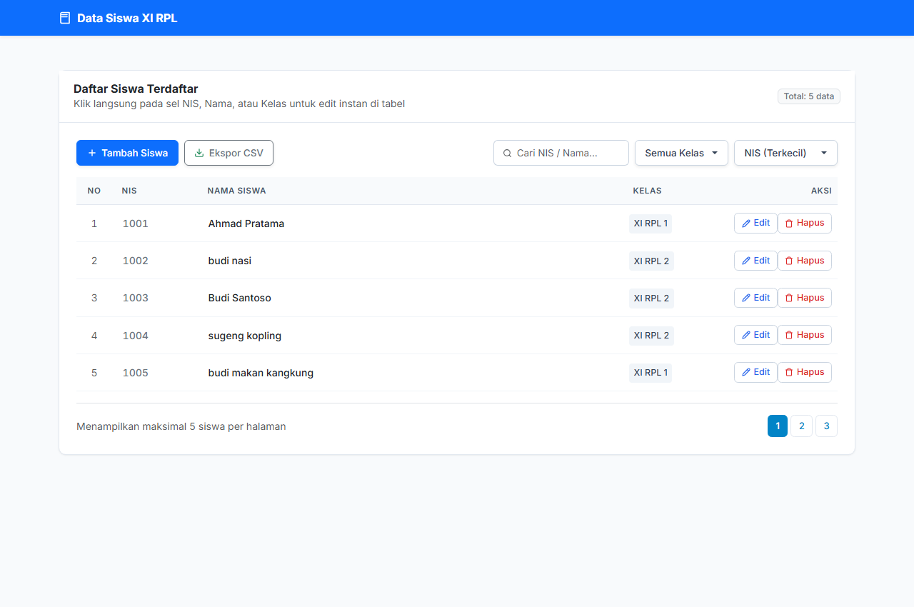

# Aplikasi Pengelolaan Data Siswa (CI4 Siswa)

## Fitur

- **CRUD Data Siswa**:
  - Tambah data siswa (NIS, Nama Lengkap, Kelas).
  - Edit data siswa menggunakan modal dialog (*reusable modal*).
  - Hapus data dengan konfirmasi dialog interaktif (SweetAlert2).
- **Inline Editing (Edit Cepat di Tabel)**:
  - Klik langsung pada sel NIS, Nama, atau Kelas di tabel untuk mengubah data secara instan.
  - Simpan otomatis saat menekan tombol **Enter** atau saat kursor keluar dari sel (*blur*).
  - Dilengkapi validasi realtime via AJAX untuk mencegah NIS duplikat/ganda.
- **Pencarian & Filter Kelas**:
  - Pencarian data siswa berdasarkan NIS maupun Nama.
  - Dropdown filter berdasarkan kelas yang diambil dinamis dari database.
- **Pengurutan Data (Sorting)**:
  - Urutkan data berdasarkan NIS (terkecil / terbesar), Nama (A - Z, Z - A), dan Kelas (A - Z).
- **Ekspor Data CSV**:
  - Unduh seluruh data siswa ke dalam file CSV yang langsung rapi dan kompatibel dibuka di Microsoft Excel.
- **Paginasi Data**:
  - Pembagian data per halaman yang rapi dan terstruktur.
- **Antarmuka Modern & Responsif**:
  - Desain bersih berbasis Bootstrap 5.3 dan tipografi Inter.
  - Dropdown kustom yang rapi dan tata letak responsif untuk desktop maupun ponsel pintar.
